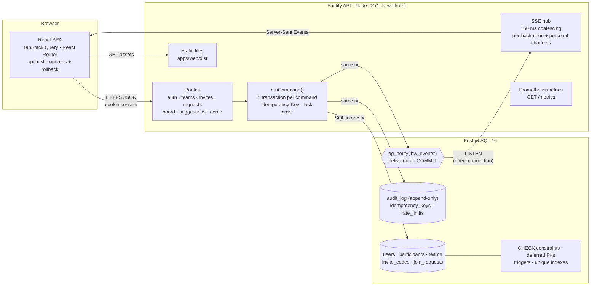
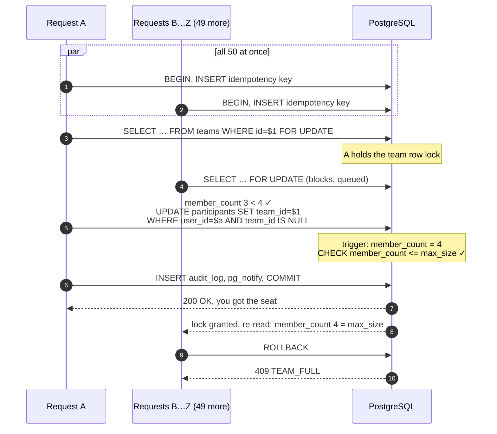
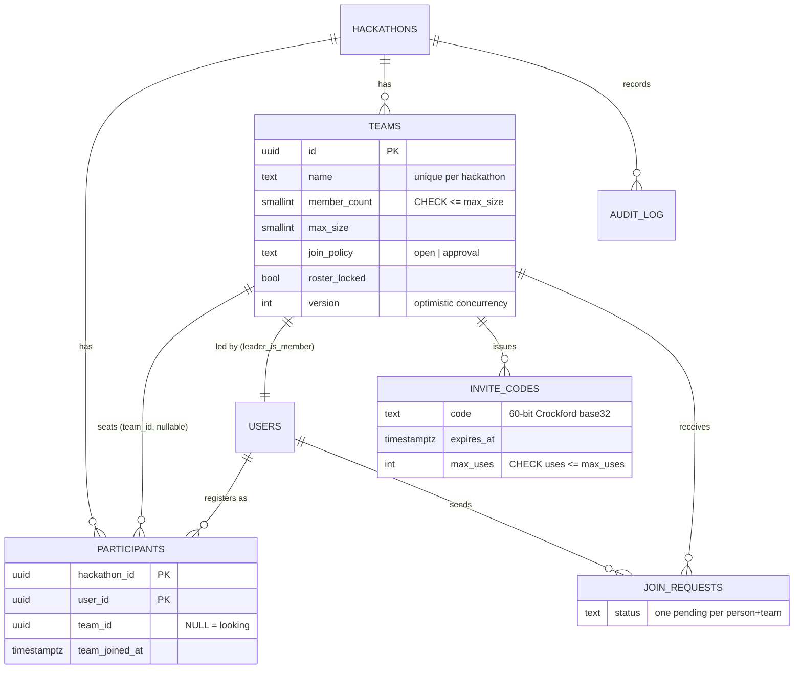

# Bandwagon

**Race-proof team formation for a 10,000-person hackathon.**

Participants form teams with expiring invite codes, send join requests that the leader accepts or declines, and browse a live "looking for teammates" board. Hundreds of people can press **Join** on the same team in the same second, and **exactly one** of them gets the last seat. Nobody ends up on two teams, a team never goes over its size limit, and a retried request never joins twice.

| | |
|---|---|
| **Live demo** | _add your Render URL here after deploying ([Deploy](#deploy-render--neon))_. No sign-up: on the sign-in page, press **Lead a team with one seat left** or **Join as a solo hacker**. |
| **Read first** | [1-page design doc](docs/design-doc.md) · [Load test](docs/LOADTEST.md) · [Chaos test](docs/CHAOS.md) |
| **Specs** | [PRD](docs/PRD.md) · [TRD](docs/TRD.md) · [Design system](DESIGN.md) · [Product context](PRODUCT.md) · [Video script](docs/VIDEO_SCRIPT.md) |

---

## Contents
1. [Highlights](#highlights)
2. [Architecture](#architecture)
3. [How "exactly one wins" works](#how-exactly-one-wins-works)
4. [Data model](#data-model)
5. [Real-time updates](#real-time-updates)
6. [Teammate suggestions](#teammate-suggestions)
7. [API reference](#api-reference)
8. [Requirements and evidence](#requirements-and-evidence)
9. [Run it locally](#run-it-locally)
10. [Testing](#testing)
11. [Configuration](#configuration)
12. [Deploy (Render + Neon)](#deploy-render--neon)
13. [Repository layout](#repository-layout)
14. [Design](#design)

---

## Highlights

- **Correct under contention.** 50 concurrent HTTP requests race for one seat, 5 rounds per scenario, across 8 scenarios. Exactly one wins every time.
- **The database enforces the rules.** One team per person is structural (a single nullable `participants.team_id`), and `CHECK (member_count <= max_size)` makes overfilling impossible even if the application code has a bug.
- **Safe retries.** Every state-changing request accepts an `Idempotency-Key`. A retry gets back the original response byte for byte.
- **Survives crashes.** The server was killed with SIGKILL 6 times during live traffic from 120 clients. Afterwards there were 0 invariant violations and the audit log matched every team exactly.
- **Fast.** With 10,000 users and 2,000 teams seeded, the board's p95 is **19.5 ms** at 100 concurrent users (the budget is 200 ms).
- **Live.** The board and team pages update over Server-Sent Events, driven by Postgres `pg_notify`, so clients only hear about committed changes.
- **Explained suggestions.** "People your team needs" scores each candidate from 0 to 100 and states every part of the score in words.
- **Accessible.** axe-core finds 0 violations on 6 pages. The UI works with the keyboard alone and on a 390 px phone with no sideways scroll.

---

## Architecture

One Node process serves both the JSON API and the built React app from the same origin, so there is no CORS and the session cookie stays first-party. PostgreSQL is the only stateful component. Locks, rate limits, idempotency keys, the audit log and the event bus all live in it, so you can run more API processes without adding Redis or a message queue.



**What happens on a write** (for example, pressing *Join*):

1. The SPA sends `POST /api/teams/:id/join` with an `Idempotency-Key` and updates the UI optimistically.
2. `runCommand()` opens a transaction and inserts the idempotency key row first. A concurrent duplicate blocks on that row, then replays the stored response.
3. The service locks rows in one global order: **team → participant → request/invite**. Every command uses the same order, so no two commands can deadlock.
4. It checks the business rules under the lock, writes the change, the audit row and a `pg_notify` event, then commits.
5. Postgres delivers the notification only after the commit. The SSE hub batches events for 150 ms and pushes them to every open board and team page.
6. If the command fails (for example `TEAM_FULL`), everything rolls back, including the idempotency key. The SPA reverts its optimistic change and shows the reason.

**Packages**

| Package | Role | Main libraries |
|---|---|---|
| [`apps/api`](apps/api) | HTTP API, SSE, migrations, seed, chaos test | Fastify 5, postgres.js, zod, prom-client |
| [`apps/web`](apps/web) | React single-page app | React 18, TanStack Query, React Router, Radix, CSS Modules, Vite |
| [`packages/shared`](packages/shared) | Code both sides import | zod schemas, skill catalogue, error codes, time-zone math, invite-code format |

---

## How "exactly one wins" works

Fifty people press *Join* on a team with one open seat:



Three independent layers make this hold:

1. **Row lock, then re-read.** `lockTeam()` takes `SELECT … FOR UPDATE` on the team and re-reads `member_count` under the lock, so the other 49 requests see the seat already taken.
2. **Conditional claim.** `UPDATE participants SET team_id = … WHERE team_id IS NULL` only changes a row for someone who is not on a team yet, so a person racing to join 5 teams lands on exactly one.
3. **Database backstop.** A trigger moves `member_count` in the same statement as the membership change, and `CHECK (member_count >= 0 AND member_count <= max_size)` rejects any write that would overfill a team.

The same pattern covers redeeming invite codes, accepting requests (including 10 parallel accepts for one seat, and two leaders accepting the same person), leaving, and deleting a team when its last member leaves. When a leader leaves, leadership passes to the longest-serving member in the same transaction. A deferred `leader_is_member` foreign key guarantees the leader is always on the team.

Source: [`teams/service.ts`](apps/api/src/modules/teams/service.ts), [`lib/command.ts`](apps/api/src/lib/command.ts), [`migrations/001_init.sql`](apps/api/migrations/001_init.sql). Tests: [`race.test.ts`](apps/api/test/race.test.ts).

---

## Data model



| Rule | How the database enforces it |
|---|---|
| One team per person per hackathon | `participants (hackathon_id, user_id)` primary key with a single `team_id` column |
| A team never overfills | `seats_within_bounds` CHECK, `member_count` maintained by a trigger |
| The leader is always a member | deferred `leader_is_member` foreign key |
| Team names are unique within a hackathon | `teams_name_unique` index |
| One pending request per person per team | `join_requests_one_pending` partial unique index |
| An invite code can't be overused | `invite_uses_within_limit` CHECK |
| The audit log can't be rewritten | `audit_log_no_update` and `audit_log_no_truncate` triggers |
| The data is consistent | `GET /api/hackathons/:id/invariants` runs SQL checks, used by the tests and the chaos run |

---

## Real-time updates

- Every command calls `pg_notify('bw_events', …)` inside its transaction, so a rolled-back change is never announced.
- Each API worker holds one `LISTEN` connection. This must be a **direct** (unpooled) connection, because PgBouncer-style poolers drop `LISTEN`.
- The hub coalesces events for `COALESCE_MS` (150 ms) and fans them out over `GET /api/hackathons/:id/events`. Heartbeats keep proxies from closing idle streams.
- Board events carry the changed team snapshot, so the client patches the board in its TanStack Query cache in place and announces filled seats to screen readers. After a dropped connection it refetches everything once. Personal events (your request was accepted, someone joined your team) go only to the people involved.

---

## Teammate suggestions

`GET /api/hackathons/:id/suggestions/people` (for team leaders) and `/suggestions/teams` (for solo participants) score candidates from 0 to 100:

| Part | Weight | What it measures |
|---|---|---|
| Complementary skills | 50 | 70% of this part is the share of the skills the team asked for that the candidate brings. 30% is the new roles (frontend, backend, mobile, design, data & ML, infra) the candidate adds that nobody on the team covers yet. |
| Time-zone overlap | 30 | Hours of working-time overlap with the *least*-overlapping current member, because a meeting needs everyone. Capped at 8 h. |
| Skill novelty | 20 | The share of the candidate's skills the team doesn't already have. |

Each part comes back with its points and a reason in plain words, such as "Brings WebGL, which your team asked for, and adds Mobile (Kotlin)". Ties go to whoever brings more of the missing skills, then more shared hours. See [`suggestions/scoring.ts`](apps/api/src/modules/suggestions/scoring.ts).

---

## API reference

All endpoints are under `/api`. Authentication uses an httpOnly `SameSite=Lax` session cookie, or `Authorization: Bearer <token>`. Every `POST`/`PATCH`/`DELETE` accepts an optional `Idempotency-Key` header (8–100 characters: letters, digits, `-`, `_`). Errors return a stable `code` from [`packages/shared/src/errors.ts`](packages/shared/src/errors.ts), such as `TEAM_FULL`, `ALREADY_IN_TEAM` or `ROSTER_LOCKED`.

<details>
<summary><b>Endpoints</b> (click to expand)</summary>

| Area | Method and path | Purpose |
|---|---|---|
| Auth | `POST /auth/signup` · `POST /auth/login` · `POST /auth/logout` · `GET /auth/me` | Session management |
| | `POST /auth/demo` | One-click demo personas (when `DEMO_MODE=true`) |
| | `PATCH /me` | Edit your profile, skills and time zone |
| Hackathons | `GET /hackathons` · `GET /hackathons/:ref` | List events, fetch one by id or slug |
| | `POST /hackathons/:id/register` · `PATCH /hackathons/:id/me` | Join an event, set what you're looking for |
| Board | `GET /hackathons/:id/board/teams` | Teams with open seats: skill, time-zone and policy filters, name search, keyset pages |
| | `GET /hackathons/:id/board/people` | People who are looking for a team |
| Teams | `POST /hackathons/:id/teams` | Create a team (you become its leader) |
| | `GET /teams/:id` · `PATCH /teams/:id` | Read or edit a team (send `expectedVersion`; a stale edit returns `412 VERSION_CONFLICT` with the current team) |
| | `POST /teams/:id/join` | Join an open-policy team |
| | `POST /teams/:id/leave` | Leave (leadership passes on; the last one out deletes the team) |
| | `POST /teams/:id/leader` · `POST /teams/:id/members/:userId/remove` · `POST /teams/:id/roster` | Leader-only: hand over leadership, remove a member, lock or unlock the roster |
| Invites | `POST /teams/:id/invites` · `DELETE /teams/:id/invites/:inviteId` | Issue or revoke a code (expiry and use limit) |
| | `GET /invites/:code` · `POST /invites/redeem` | Preview a code, then take a seat with it |
| Requests | `POST /teams/:id/requests` · `GET /hackathons/:id/me/requests` | Ask to join, list your requests |
| | `POST /requests/:id/accept` · `/decline` · `/cancel` | Leader decides, or the requester withdraws |
| Suggestions | `GET /hackathons/:id/suggestions/people` · `/suggestions/teams` | Scored, explained matches |
| Live | `GET /hackathons/:id/events` | Server-Sent Events stream |
| Audit | `GET /teams/:id/audit` · `GET /hackathons/:id/audit` | Append-only history |
| Demo | `POST /demo/race` | Race Arena: 50 bot transactions for one seat |
| Ops | `GET /healthz` · `GET /readyz` · `GET /metrics` · `GET /api/hackathons/:id/invariants` | Liveness, readiness, Prometheus metrics, consistency check |

</details>

---

## Requirements and evidence

| Requirement | How | Evidence |
|---|---|---|
| 50 people, 1 last seat, exactly 1 wins | Team row lock + conditional claim + `CHECK (member_count <= max_size)` | [`race.test.ts`](apps/api/test/race.test.ts): 8 scenarios × 5 rounds × 50 concurrent HTTP requests |
| One team per person per hackathon | Structural: one nullable `participants.team_id` | [`001_init.sql`](apps/api/migrations/001_init.sql), race and schema tests |
| Retries never double-join or double-create | `Idempotency-Key` row inside the command's transaction; byte-identical replays | [`idempotency.test.ts`](apps/api/test/idempotency.test.ts), chaos double-sends |
| Leadership passes on; the last one out deletes the team | Same transaction as the leave; deferred `leader_is_member` FK | [`teams.test.ts`](apps/api/test/teams.test.ts) |
| Invite codes expire and can't be brute-forced | 60-bit Crockford codes; Postgres-backed limits per user and IP; 5 wrong guesses → 15-minute lockout | [`invites.test.ts`](apps/api/test/invites.test.ts) |
| Only the leader accepts, declines or removes | Checked under the team lock | teams and requests tests |
| Audit log of every change | Same transaction; append-only by trigger | [`audit.test.ts`](apps/api/test/audit.test.ts), chaos reconciliation |
| Real-time board and team pages | SSE fed by `pg_notify` (delivered only on commit), 150 ms coalescing | [`events.test.ts`](apps/api/test/events.test.ts) |
| Teammate suggestions with explained scoring | 50·complement + 30·time-zone + 20·novelty, with reasons in words | [`scoring.test.ts`](apps/api/test/scoring.test.ts), [`suggestions.test.ts`](apps/api/test/suggestions.test.ts) |
| ≥ 20 API tests in CI | **86 API tests** (+14 shared, +6 web) | [`ci.yml`](.github/workflows/ci.yml) |
| Seed 10k users / 2k teams; p95 < 200 ms at 100 users | Deterministic seed in about 7 s; k6 | **p95 19.5 ms**, [LOADTEST.md](docs/LOADTEST.md) |
| React UI that works on phones and with a keyboard | Party Lineup design system; skip link, focus management, live regions | axe-core: 0 violations on 6 pages ([review script](apps/web/scripts/review.mjs)) |
| Bonus: optimistic UI + rollback | Join, request, accept/decline, team edits (412 conflict flow) | [`mutations.ts`](apps/web/src/lib/mutations.ts) |
| Bonus: Docker Compose | `docker compose up --build` | [`docker-compose.yml`](docker-compose.yml) |
| Bonus: metrics | Prometheus at `/metrics`: latency histogram, seat-claim outcomes, retries, SSE clients | [`metrics.ts`](apps/api/src/lib/metrics.ts) |
| Bonus: chaos test | SIGKILL the server 6× mid-join; 0 violations | `pnpm chaos`, [CHAOS.md](docs/CHAOS.md) |
| Bonus: Race Arena | 50 concurrent bot transactions on demand, in the UI | `/h/hack4hack-2026/arena` |

---

## Run it locally

### Option A: Docker (one command)
```bash
docker compose up --build        # → http://localhost:8080 (the first boot seeds 10k users / 2k teams)
```

### Option B: without Docker
You need Node 22 and pnpm 11. Postgres is installed from npm as native binaries, so there is nothing else to install.

```bash
pnpm install
pnpm -F @bw/api localdb                       # terminal 1: Postgres 16 on :54329
pnpm -F @bw/api seed --reset                  # 10,000 users, 2,000 teams
pnpm -F @bw/web build
cd apps/api && DEMO_MODE=true WEB_DIST=../web/dist pnpm dev   # → http://localhost:8080
```

For UI work, run `pnpm -F @bw/web dev` instead and open http://localhost:5173. Vite proxies `/api` to the API.

### Try it
1. On the sign-in page, press **Lead a team with one seat left**. You arrive on your team page with pending join requests.
2. Open a second browser (or a private window) and press **Join as a solo hacker**. Ask to join the first team, and watch the request arrive live.
3. Open **Race arena** and press **Start the race**. 50 bots race for one seat, and the winner is dealt into the hand.

---

## Testing

```bash
pnpm test                                     # shared + API (against real Postgres) + web
pnpm -F @bw/api test race                     # only the concurrency suite
pnpm -F @bw/api build && pnpm chaos           # chaos test → docs/CHAOS.md
k6 run -e BASE_URL=http://127.0.0.1:8080 loadtest/board.k6.js
```

| Suite | Count | What it covers |
|---|---|---|
| API (`apps/api/test`) | 86 | Races, idempotency, invites, requests, teams, board, suggestions, audit, SSE, auth, schema, demo |
| Shared (`packages/shared`) | 14 | Invite-code format, time-zone overlap, schemas |
| Web (`apps/web`) | 6 | Formatting and UI helpers |

API tests use `TEST_DATABASE_URL` (default: the local database above). In CI, GitHub Actions runs four jobs on every push:

- **test:** typecheck and all suites against a `postgres:16` service container.
- **load:** seeds the data and runs k6. The build fails if the browse p95 reaches 200 ms.
- **chaos:** runs the kill-and-restart test.
- **docker:** builds the image and checks that it starts healthy.

---

## Configuration

| Variable | Default | Purpose |
|---|---|---|
| `DATABASE_URL` | local DB | Main connection (pooled is fine) |
| `DATABASE_URL_UNPOOLED` | `DATABASE_URL` | Direct connection for `LISTEN` (required behind PgBouncer or Neon pooling) |
| `SESSION_SECRET` | dev value | Signs session tokens. **Set this in production.** |
| `APP_ORIGIN` | — | Public URL, used for links and cookie and origin checks |
| `PORT` / `HOST` | `8080` / `0.0.0.0` | Listen address |
| `WEB_DIST` | — | Path to the built SPA to serve |
| `DEMO_MODE` | `false` | Enables one-click personas and the Race Arena |
| `SEED_IF_EMPTY` | `false` | Seeds the demo data on first boot |
| `DB_POOL_MAX` | `20` | Connections per worker |
| `WEB_CONCURRENCY` | `1` | Number of cluster workers |
| `RATE_LIMIT_MAX` | `600` | Requests per minute per user (or per IP when signed out); sensitive routes add stricter Postgres-backed limits |
| `COALESCE_MS` / `HEARTBEAT_MS` | `150` / `20000` | SSE batching window and keep-alive interval |
| `LOG_LEVEL` | `info` | pino log level |

The full list, with validation, is in [`apps/api/src/config.ts`](apps/api/src/config.ts).

---

## Deploy (Render + Neon)

Both have free tiers.

1. Create a free **Neon** project. Copy the **pooled** connection string and the **direct** (unpooled) one.
2. Push this repo to GitHub. In **Render**, choose **New → Blueprint** and pick the repo. Render reads [`render.yaml`](render.yaml), which builds the [`Dockerfile`](Dockerfile).
3. When prompted, set:
   - `DATABASE_URL`: the pooled string.
   - `DATABASE_URL_UNPOOLED`: the direct string. LISTEN/NOTIFY needs it.
   - `APP_ORIGIN`: your `https://….onrender.com` URL.

   Render generates `SESSION_SECRET` for you.
4. The first boot runs migrations and seeds the demo data, which takes about 30 s. The free instance sleeps after 15 minutes idle, so the first request after that is slow.

The Docker image is multi-stage, runs as the non-root `node` user, contains only production dependencies, and has a `/healthz` health check.

---

## Repository layout

```
.
├── apps/
│   ├── api/
│   │   ├── migrations/          SQL schema, constraints, triggers, invariant checks
│   │   ├── src/
│   │   │   ├── db/              pool, transactions, migrator
│   │   │   ├── lib/             runCommand, errors, audit, notify, rate limits, metrics
│   │   │   ├── modules/         auth · teams · invites · requests · board · suggestions
│   │   │   │                    events (SSE hub) · audit · demo · hackathons · ops
│   │   │   ├── seed/            deterministic 10k-user seed, chaos test
│   │   │   └── server.ts        entry point (optional cluster mode)
│   │   └── test/                Vitest suites against real Postgres
│   └── web/
│       ├── src/pages/           Board, MyTeam, TeamView, Requests, Suggestions, Arena, Auth…
│       ├── src/components/      SeatSlots, TeamCard, PersonCard, ScoreBreakdown, Shell, ui
│       └── src/lib/             API client, optimistic mutations, live events
├── packages/shared/             schemas, skills, errors, time zones, invite codes
├── loadtest/                    k6 scripts
├── docs/                        PRD, TRD, design doc, load and chaos reports, video script
├── Dockerfile · docker-compose.yml · render.yaml
└── DESIGN.md · PRODUCT.md
```

---

## Design

The UI's visual world, **Party Lineup**, was chosen with the impeccable design process. Each participant is a card with a stat block, and each team is a hand of seats that fills live in front of everyone:

- **Open** seats are outlined, **claiming** seats are hatched, and **taken** seats are filled with the member's skill colour.
- **Your** card has a foil edge. Foil is never used for anyone else.

Every skill-colour pairing passes WCAG AA contrast, and state is never shown by colour alone. The full system is in [DESIGN.md](DESIGN.md), and the product context in [PRODUCT.md](PRODUCT.md).
